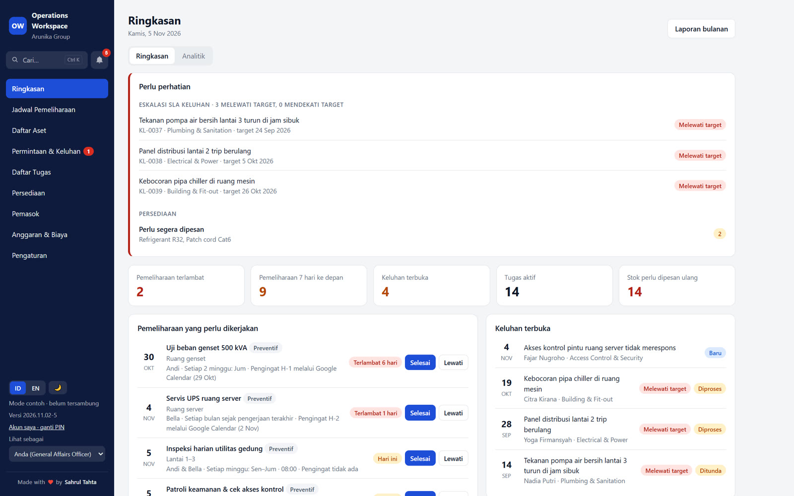
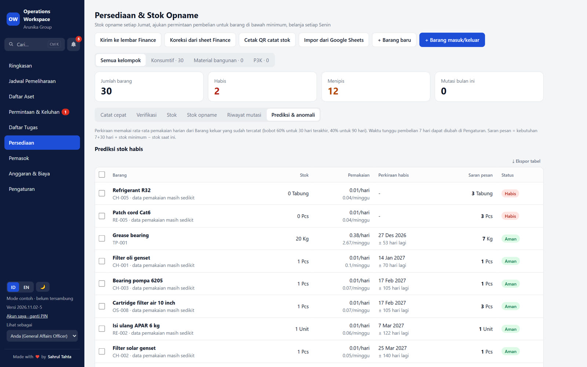
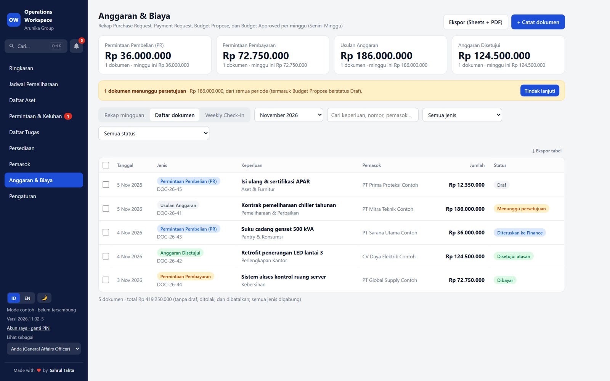
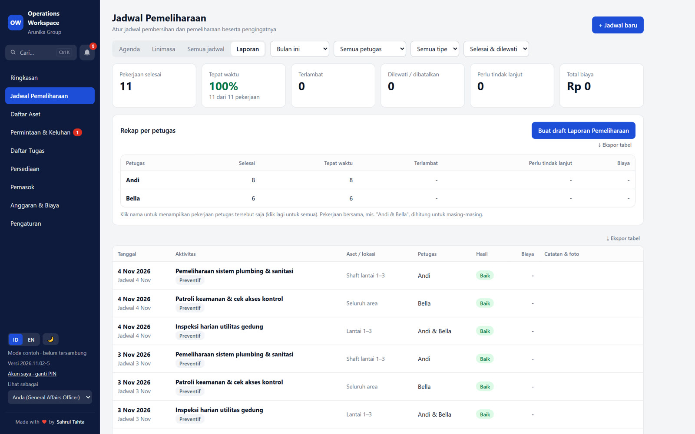
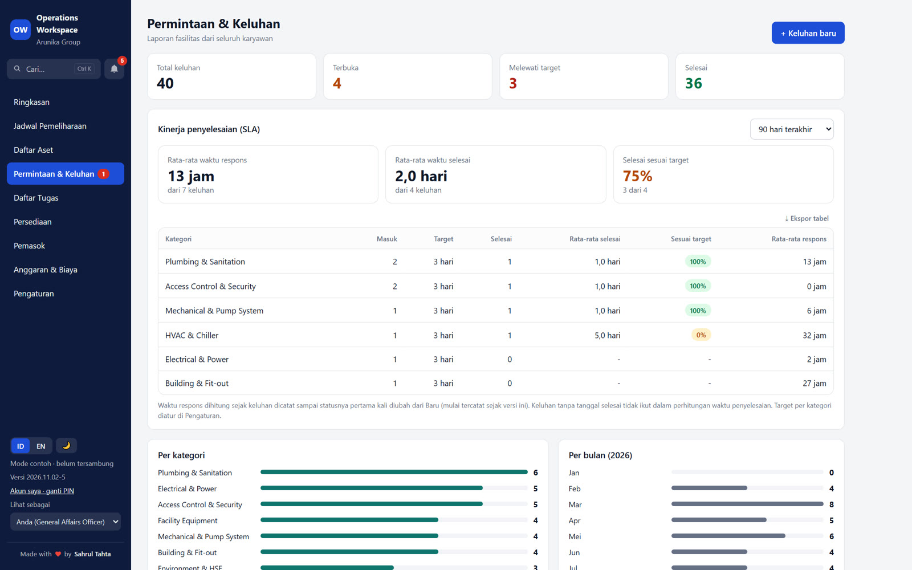
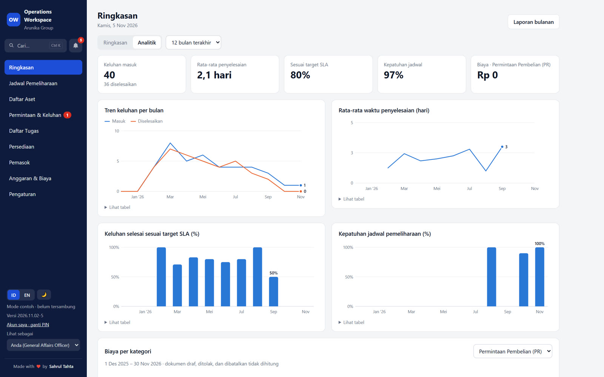

# Business Process Understanding

**Studi kasus pribadi:** memetakan, menyederhanakan, dan mengintegrasikan proses operasional dengan dukungan AI.

**[▶ Coba demo langsung di browser](https://sahrultahta.github.io/business-process-understanding/)**: tanpa instalasi, tanpa login.

> Demo dan semua tangkapan layar memakai **data fiktif**. Repository ini tidak memuat data, nama, atau tautan milik organisasi mana pun.

🎬 Video ringkas: [`docs/Business-Process-Understanding.mp4`](docs/Business-Process-Understanding.mp4) · 📄 Ringkasan 3 halaman: [`docs/Business-Process-Understanding-Carousel.pdf`](docs/Business-Process-Understanding-Carousel.pdf)

---

## Latar belakang

Operasional berjalan dalam ritme mingguan yang terencana: pencatatan, rekonsiliasi, pengarsipan, dan pelaporan. Ritmenya terencana, tetapi inefisiensi muncul pada **perpindahan data antartahap**: pencatatan ulang, pemindahan antartab, dan unggah manual.

Setiap proses dipetakan tahap demi tahap, titik kendalanya ditandai, lalu dipisahkan antara tahap yang membutuhkan keputusan manusia dan tahap yang dapat dikerjakan sistem.

## Nilai yang dijaga

| Ukuran | Wujud dalam sistem |
|---|---|
| **Efisiensi kerja** | Tahap manual berkurang 60–80% pada tiga proses inti |
| **Efektivitas pekerjaan** | Prioritas jelas sejak laporan masuk, tindak lanjut terjadwal |
| **Transparansi pengelolaan** | Setiap persetujuan tercatat dengan nama dan waktu |
| **Akurasi data** | Satu sumber data, terlindung dari perubahan yang saling menimpa |
| **Kualitas pekerjaan** | Bukti foto, kepatuhan jadwal, dan SLA yang terukur |
| **Kemudahan pemeliharaan** | Kategori, status, alur, dan model AI diatur dari Pengaturan tanpa mengubah kode |

## Tiga proses inti

### 1. Inventory control & warehouse

| | Cara lama | Cara baru |
|---|---|---|
| Tahap oleh manusia | 5 | 2 |
| Alur | Pencatatan mutasi harian manual → konsolidasi catatan → rekonsiliasi mingguan terjadwal → koreksi selisih & input ulang → penyusunan laporan | Pencatatan mutasi real-time → verifikasi |
| Dikerjakan sistem | – | Saldo stok real-time, prakiraan habis & saran pemesanan, sinkron ke lembar stock opname & Finance |
| Dampak | Selisih kuantitas dan data tidak tercatat; laporan paling cepat H+1 | Posisi stok akurat setiap saat, tanpa rekonsiliasi ulang |

### 2. Procurement & RFQ

| | Cara lama | Cara baru |
|---|---|---|
| Tahap oleh manusia | 6 | 2 |
| Alur | Penyusunan tabel penawaran → kelengkapan detail vendor → pemilihan penawaran → pemindahan data ke tab berikutnya → pengumpulan dokumen ke HP/PC → pengarsipan ke Google Drive | Input penawaran → persetujuan atasan |
| Dikerjakan sistem | – | Perbandingan vendor terstruktur; alur Draf → Diajukan → Disetujui → Diteruskan ke Finance → Dibayar; setiap langkah tercatat dengan nama & waktu |
| Dampak | Jejak keputusan sulit ditelusuri | Transparan dan dapat diaudit di setiap tahap |

### 3. Asset & maintenance management

| | Cara lama | Cara baru |
|---|---|---|
| Tahap oleh manusia | 5 | 1 |
| Alur | Dokumentasi dikirim lewat chat → unduh ke HP/PC → unggah ke Google Drive → pemilahan ke folder pekerjaan → rekap laporan manual | Pelaksana melaporkan pekerjaan beserta foto bukti |
| Dikerjakan sistem | – | Jadwal berulang & pengingat Google Calendar, rekap kepatuhan jadwal per petugas, riwayat aset & arsip foto terpusat |
| Dampak | Arsip tidak seragam, riwayat aset terputus antarperiode | Terekap dan terarsip dalam kurang dari 5 menit |

## Manusia + AI

Laporan yang masuk lewat formulir atau QR aset dianalisis **AI melalui API key**: kategori dipilih dari daftar yang ditetapkan organisasi, prioritas diberikan, ringkasan dan saran awal ditulis, lalu target SLA ditetapkan. **Tim tetap memverifikasi, menyetujui, dan menugaskan.** Email, nomor telepon, dan deretan angka panjang disamarkan sebelum dikirim ke AI.

## Pelaporan

Ringkasan operasional, kinerja SLA, kepatuhan jadwal, rekap anggaran mingguan, serta laporan bulanan Google Docs + PDF tersusun otomatis dari satu sumber data.

## Enterprise-friendly

Dirancang untuk perusahaan menengah hingga besar:

- Kontrol akses berbasis peran
- Alur persetujuan berjenjang
- Jejak audit menyeluruh
- Tata kelola multi-divisi
- Integritas data terjaga dari perubahan yang saling menimpa
- Konfigurasi tanpa kode: kategori, status, alur, dan model AI
- Identitas dan tema korporat yang dapat disesuaikan
- Pencadangan data terjadwal
- Tanpa biaya infrastruktur server
- Terintegrasi native dengan Google Workspace (Sheets, Drive, Calendar, Tasks, Forms), dengan arsitektur yang dapat diperluas ke Microsoft 365 dan platform kerja lainnya

## Modul

- **Ringkasan & analitik:** hal yang perlu perhatian, eskalasi SLA, kepatuhan jadwal
- **Asset & maintenance:** daftar aset, label QR, audit aset, nilai & penyusutan, jadwal preventif dan korektif
- **Permintaan & keluhan:** formulir publik, QR aset, analisis AI, kinerja SLA
- **Tugas:** papan kanban, sinkron Google Tasks dan Calendar
- **Inventory:** mutasi stok, verifikasi, stock count, prakiraan habis & anomali, sinkron ke lembar stock opname
- **Procurement & anggaran:** pembanding penawaran, alur persetujuan sampai pembayaran, rekap mingguan
- **Keamanan:** login PIN, hak akses per peran, jejak audit, pencegahan data tertimpa, cadangan mingguan

## Arsitektur

- **Server:** Google Apps Script
- **Antarmuka:** aplikasi web satu halaman
- **Basis data:** Google Sheets, satu tab per tabel
- **Integrasi:** Google Drive, Calendar, Tasks, Forms, dan AI melalui API key

## Coba demo

**[▶ Buka demo langsung](https://sahrultahta.github.io/business-process-understanding/)**: berjalan di browser tanpa instalasi dan tanpa login, memakai data fiktif. Perubahan yang Anda buat di demo tidak tersimpan.

## Implementasi

Kode sumber tidak dipublikasikan. Untuk implementasi di organisasi Anda, termasuk penyesuaian alur, kategori, dan integrasi, silakan hubungi melalui [LinkedIn](https://www.linkedin.com/in/sahrul-tahta-gunawan-08110a235/).

## Arah pengembangan

Proyeksi berikutnya:

- **Integrasi ERP:** menghubungkan pengadaan dan persediaan dengan sistem keuangan perusahaan
- **Multi-site & multi-gudang:** konsolidasi stok dan aset lintas lokasi dalam satu tampilan
- **Perawatan prediktif:** membaca riwayat aset untuk menjadwalkan sebelum terjadi kerusakan
- **Dashboard eksekutif:** indikator operasional lintas unit untuk pengambilan keputusan

---

## Hak cipta & kolaborasi

© 2026 Sahrul Tahta. Seluruh hak dilindungi.

- **Aplikasi & demo:** Proprietary, seluruh hak dilindungi. Boleh dilihat dan dicoba, tidak boleh disalin, diubah, atau dipakai secara komersial.
- **Video, carousel, tangkapan layar & teks README:** [CC BY-NC-ND 4.0](https://creativecommons.org/licenses/by-nc-nd/4.0/). Boleh dibagikan ulang dengan mencantumkan nama Sahrul Tahta, tanpa diubah dan bukan untuk komersial.

Rincian lengkap ada di [LICENSE](LICENSE). Terbuka untuk diskusi, kolaborasi, maupun implementasi di organisasi Anda. Silakan hubungi melalui [LinkedIn](https://www.linkedin.com/in/sahrul-tahta-gunawan-08110a235/).

---

Made with ❤️ by **Sahrul Tahta**
